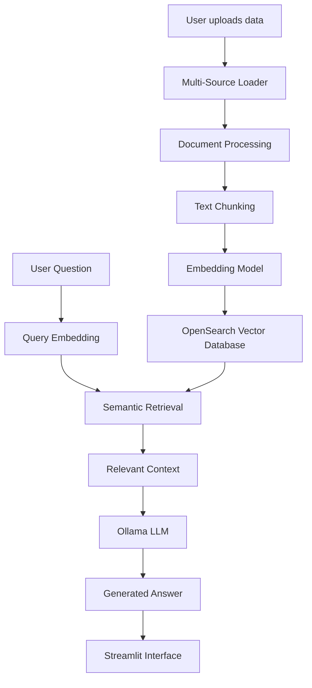

# ✦ Aavya AI — Multi-Source RAG Analytics Assistant

An AI-powered knowledge and business analytics platform that allows users to upload multiple data sources, perform semantic search, retrieve relevant information, and generate answers using Retrieval-Augmented Generation (RAG).

Built using Python, Streamlit, Hugging Face Sentence Transformers, OpenSearch, and Ollama.

---

## 🚀 Overview

Aavya AI combines document intelligence and business analytics in one application.

Users can upload CSV files, text documents, Markdown files, and SQLite databases. The application processes the uploaded data, generates vector embeddings, stores them in OpenSearch, and retrieves relevant information to answer natural-language questions.

For supported numerical questions, Aavya AI also uses Pandas to calculate business metrics directly from uploaded CSV data.

## ✨ Features

- **Multi-source ingestion:** CSV, TXT, Markdown, and SQLite databases.
- **Document processing:** Splits documents into smaller overlapping text chunks.
- **Semantic embeddings:** Uses `sentence-transformers/all-MiniLM-L6-v2`.
- **Vector database:** Stores and retrieves embeddings using OpenSearch.
- **AI-powered answers:** Uses Ollama with the `llama3.2:3b` model.
- **Source-aware retrieval:** Displays retrieved document chunks and similarity scores.
- **Business analytics:** Calculates revenue, units sold, unique products, and product-level revenue.
- **Interactive dashboard:** Built using Streamlit.

## 🛠️ Technology Stack

| Component | Technology |
|---|---|
| Programming language | Python 3.11 |
| Frontend | Streamlit |
| Data processing | Pandas |
| Embedding model | Hugging Face Sentence Transformers |
| Vector database | OpenSearch 2.19.1 |
| Large Language Model | Ollama — Llama 3.2 3B |
| Database ingestion | SQLite |
| Testing | Pytest |
| Containerization | Docker |


## 🏗️ Architecture




## 📂 Project Structure

```text
multi-source-rag-analytics-assistant/
│
├── data/
│   └── sample_documents/
│       ├── company_overview.txt
│       ├── sales.csv
│       └── technova_sample.db
│
├── src/
│   ├── __init__.py
│   ├── analytics.py
│   ├── embeddings.py
│   ├── loaders.py
│   ├── opensearch_store.py
│   └── rag_pipeline.py
│
├── tests/
│   ├── test_loaders.py
│   ├── test_opensearch_store.py
│   └── test_rag_pipeline.py
│
├── app.py
├── docker-compose.yml
├── requirements.txt
├── README.md
└── .gitignore
```

## ⚙️ Installation and Setup

### 1. Clone the repository

```bash
git clone https://github.com/pprotonn/multi-source-rag-analytics-assistant.git

cd multi-source-rag-analytics-assistant
```

### 2. Create a virtual environment

Windows PowerShell:

```powershell
python -m venv .venv

.\.venv\Scripts\Activate.ps1
```

If PowerShell blocks activation, run:

```powershell
Set-ExecutionPolicy -Scope Process -ExecutionPolicy Bypass
```

Then activate the environment again.

### 3. Install dependencies

```bash
python -m pip install --upgrade pip

pip install streamlit pandas sentence-transformers opensearch-py requests pytest
```

### 4. Start OpenSearch

Make sure Docker Desktop is running.

```bash
docker compose up -d
```

OpenSearch should be accessible at:

```text
http://localhost:9200
```

### 5. Install and start Ollama

Install Ollama from:

https://ollama.com/

Download the model:

```bash
ollama pull llama3.2:3b
```

Make sure the Ollama service is running.

### 6. Run the application

```bash
python -m streamlit run app.py
```

Open the local URL displayed in your terminal, usually:

```text
http://localhost:8501
```

## 📊 Sample Data

The repository includes sample data for testing:

- `company_overview.txt` — company information.
- `sales.csv` — sample sales records.
- `technova_sample.db` — SQLite sample database.

You can upload these files through the Streamlit interface to test the application.

## 🧪 Running Tests

Run the test suite using:

```bash
python -m pytest -v
```

The project has previously completed all 13 automated tests successfully.

## 💡 Example Questions

Try asking Aavya AI:

**Document questions**
- Where is TechNova Solutions headquartered?
- How many employees does the company have?
- What products does the company offer?

**Business analytics questions**
- What is the total revenue?
- Which product sold the most units?
- How many units were sold?

## 🔄 RAG Workflow

1. Upload documents or databases.
2. Load content using the multi-source loader.
3. Split content into smaller chunks.
4. Generate embeddings using Sentence Transformers.
5. Store document chunks and embeddings in OpenSearch.
6. Convert the user's question into an embedding.
7. Retrieve relevant chunks using vector similarity search.
8. Send retrieved context and the question to Ollama.
9. Display the generated answer and retrieved sources.

## 🔮 Future Improvements

- Conversational memory and follow-up questions.
- Improved hybrid search combining keyword and vector retrieval.
- Better source attribution and answer evaluation.
- Authentication and user-specific document management.
- Cloud deployment.
- Advanced analytics and interactive visualizations.

## 👨‍💻 Author

**Ritesh Kumar Singh**

GitHub: [@pprotonn](https://github.com/pprotonn)

---

⭐ If you find this project interesting, consider giving the repository a star!
